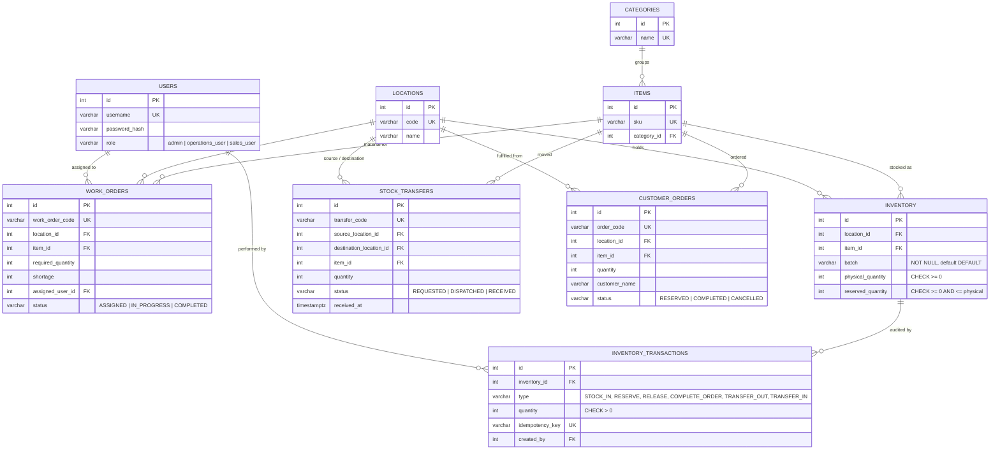

# Database Schema / ER Diagram

Source of truth: `backend/db/schema.sql`.

## Key integrity decisions

- **Available quantity** is never stored; it is `physical_quantity - reserved_quantity`, so it cannot drift.
- **Database CHECK constraints** make negative stock and reserving beyond physical stock impossible even if application code is wrong.
- **One stock row per location + item + batch**, with batch never NULL, so the UNIQUE constraint works.
- **Row locks** (`SELECT ... FOR UPDATE`) on stock and transfer rows serialize concurrent requests.
- **Transfer state machine** `REQUESTED -> DISPATCHED -> RECEIVED` is checked under lock, so a transfer is credited to the destination at most once.
- **Idempotency key** on stock-in is UNIQUE in the audit log, preventing duplicate postings.
